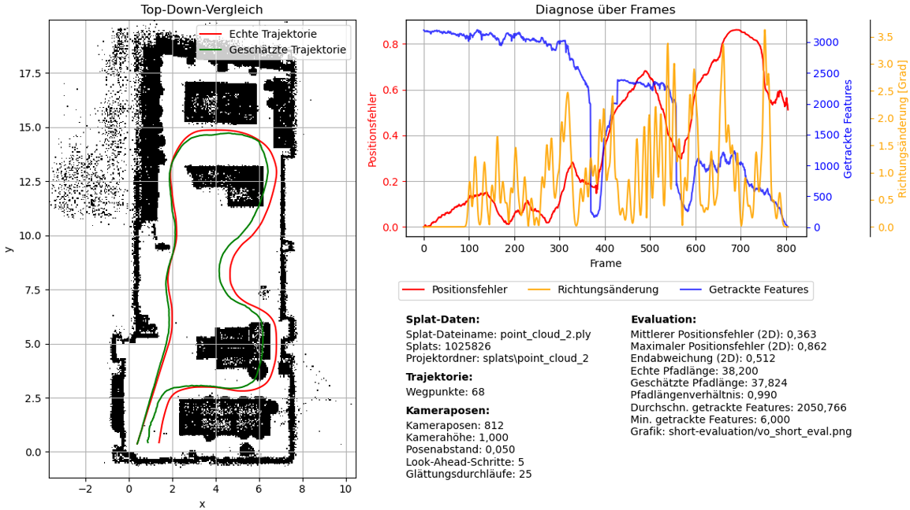

# Pipeline zur Simulation und Evaluation visueller Lokalisierung in 3D-Gaussian-Splat-Umgebungen
### Projektinfos
**Modul:** Perzeptionssysteme für mobile Agenten  
**Semester:** Sommersemester 2026  
**Projektteam:** Paul Weigert, Marco Weber  

## Überblick

Dieses Python-basierte GUI-Tool führt schrittweise durch eine Pipeline zur Erzeugung synthetischer Bildsequenzen und Referenzdaten aus einer 3D-Gaussian-Splat-Umgebung. Ziel ist es, prototypisch zu untersuchen, inwiefern sich solche simulierten Bilddaten für Visual Odometry eignen und welchen Einfluss Parameter wie Trajektorienverlauf, Kameraposen, Blickrichtung und Bildgenerierung auf die geschätzte Trajektorie haben.

Beispiel einer Kurz-Evaluation

<a href="./doc/short_eval.png">
  
</a>

*Links der Vergleich von Referenztrajektorie und geschätzter Trajektorie. Rechts oben der Verlauf von Positionsfehler, Richtungsänderung und Anzahl der getrackten Bildmerkmale. Darunter stehen die Versuchsparameter, etwa Kamerahöhe und Glättung, sowie Evaluationskennzahlen wie der mittlere Positionsfehler und die Endabweichung.*

\
Aus einer Gaussian-Splat-Datei im `.ply`-Format werden zunächst eine Bodenebene und eine passende Ausrichtung des Raums bestimmt. Daraus werden eine Transformation sowie ein Occupancy Grid erzeugt, das als Grundlage für die weitere Simulation dient.

Auf dem Occupancy Grid kann anschließend eine Fahrtrajektorie eingezeichnet werden. Entlang dieser Trajektorie werden Kameraposen aus Sicht eines Roboters berechnet und für den Import in den [SuperSplat Editor](https://superspl.at/editor) vorbereitet, um dort Bilddaten bzw. ein Video zu rendern.

Die erzeugten Bilddaten werden anschließend zusammen mit der bekannten Referenztrajektorie von einer Visual Odometry verarbeitet.  
Die verwendete Visual Odometry basiert auf der OpenCV-basierten Monocular Visual Odometry von [Avi Singh](https://github.com/avisingh599/mono-vo). Als Python-Implementierung wurde das Repository „[Monocular-Video-Odometry](https://github.com/alishobeiri/Monocular-Video-Odometery/tree/master)“ von Ali Shobeiri als Grundlage verwendet und im Rahmen dieses Projekts um zusätzliche Auswertungsmetriken sowie die automatische Speicherung relevanter Evaluationsdaten als CSV-Datei erweitert.

Nach einem Visual-Odometry-Lauf kann eine kurze Evaluation des ausgeführten Laufs angezeigt werden. Zusätzlich kann auch direkt aus dem Python-Tool heraus über ein R-Skript eine ausführliche PDF-Evaluation erstellt werden, wobei hier auch mehrere Läufe im direkten Vergleich angezeigt werden können.

### Einschränkungen

Das Tool wurde mit Gaussian Splats unterschiedlicher Auflösungsstufen des Vorlesungsraums T1.1.08 der Hochschule Pforzheim validiert.
Die entsprechenden .PLY-Dateien sind unter nachfolgendem Link mit einem Microsoft-Office Konto der Hochschule herunterladbar: [GaussianSplatting_T1_1_08_3D_Cam](https://hspforzheimde-my.sharepoint.com/:u:/g/personal/maxim_dolgov_hs-pforzheim_de/IQD-km17JtNoToQ9DAwK7r1JAewIAJQ-nyqFfP4p7dXAHis?e=QqFlH3)  
Die Nutzung mit anderen Gaussian-Splat-Umgebungen ist grundsätzlich möglich. Für gute Ergebnisse sollte die Szene eine ausreichend ebene Bodenfläche und einen sinnvoll abgegrenzten Raumbereich besitzen. Bei stark abweichenden Skalierungen können jedoch einzelne Parameteranpassungen im Code erforderlich sein.


## Grundprinzip

Die Pipeline besteht aus drei Hauptschritten:

1. **Bodenebene und Referenzkoordinatensystem bestimmen und Koordinatentransformation erzeugen**
2. **Trajektorie festlegen, Kameraposen generieren und Bilddaten generieren**
3. **Visual Odometry vorbereiten, ausführen und Ergebnisse evaluieren**

Die Hauptschritte 1, 2 und 3 sowie die Zwischenschritte (z. B. 1A, 1B usw.) bauen aufeinander auf. 


### Ablauf der Pipeline

**1A:** Splat-Datei auswählen und Kandidaten für die Bodenebene suchen  
**1B:** Bodenebene validieren und relevanten Höhenbereich für Occupancy Grid einstellen  
**1C:** Raum ausrichten und Ursprung setzen  
**1D:** Transformation zwischen Simulations- und Splat-Koordinatensystem sowie Occupancy Grid generieren  
**2A:** Trajektorie einzeichnen  
**2B:** Kameraposen mit gewünschten Parametern generieren  
**2C:** Kameraposen im Format für SuperSplat generieren und Video im SuperSplat Editor rendern  
**3A:** Bilder und Ground-Truth für Visual Odometry vorbereiten  
**3B:** Visual Odometry ausführen und Ausgabe speichern  
**3C:** Kompakte Evaluation anzeigen und Evaluationsdaten speichern  
**3D:** Ausführliche PDF-Evaluation vorbereiten und generieren

### Projektordner

Für jede im Schritt 1A ausgewählte Splat-Datei wird nach der Transformationsberechnung in Schritt 1D ein eigener **Splat-Ordner** unter `splats/<splat file name>` angelegt.

In diesem Ordner werden die Ergebnisse und Daten der einzelnen Schritte gespeichert, ergänzt und abgerufen. Dadurch kann nach einem Neustart oder Programmabsturz an einem späteren Schritt weitergearbeitet werden.

Hierzu wird in Schritt 2A bzw. Schritt 3A der passende Splat-Ordner ausgewählt, um vorhandene Daten zu lesen und neue Daten zu schreiben.

Ein Schritt kann beliebig erneut ausgeführt werden, dann werden bereits vorhandene Ergebnisse im zugehörigen Ordner überschrieben.

Beispielsweise können aus derselben gespeicherten Transformation und Trajektorie mehrfach Kameraposen mit unterschiedlichen Parametern für eine vergleichbare Evaluation generiert werden. Sollen die zuvor generierten Daten bestehen bleiben, kann der entsprechende Splat-Ordner kopiert und umbenannt werden.

### OK-Markierungen

Die Tabs der einzelnen Zwischenschritte werden mit `[OK]` markiert, sobald die jeweiligen Ausgabedaten des Schritts vorhanden sind. Das kann direkt nach dem Ausführen eines Schritts passieren oder beim erneuten Öffnen bzw. Auswählen eines vorhandenen Splat-Ordners, wenn die passenden Dateien bereits vorhanden sind.  
Die OK-Anzeige bedeutet also: Die Daten für diesen Schritt liegen vor und der nächste Schritt kann darauf aufbauen. Fehlen Dateien oder wurde ein Schritt noch nicht ausgeführt, bleibt der Tab offen markiert.  
Hinweis: Die [OK]-Markierung erkennt keine nachträglichen Inkonsistenzen. Werden zum Beispiel in Schritt 2B die Kameraposen geändert, müssen Schritt 2C und 3A, vor der Odometry in 3B, erneut ausgeführt werden, auch wenn diese Tabs weiterhin mit [OK] markiert sind.


### Beispieldateien
Das Repository enthält bereits beispielhaft erzeugte Pipeline- und Evaluationsdaten.  
Im Splat-Ordner `splats/point_cloud_2_traj2_lookahead5_smoothing25` befinden sich bereits die Daten eines vollständigen Pipeline-Durchlaufs. Nach Auswahl dieses Splat-Ordners in Schritt 2A oder 3A können über die vorhandenen Daten beliebige Pipeline-Schritte ausgeführt werden.  
Hinweis: Vor der Ausführung der Visual Odometry in Schritt 3B müssen die Daten zunächst in Schritt 3A vorbereitet werden. Die Einzelbilder sind aufgrund ihres Speicherbedarfs nicht in der Abgabe enthalten und werden in Schritt 3A aus dem vorhandenen .mp4-Video extrahiert.

Im Ordner `evaluation/` liegen zusätzlich beispielhafte Evaluationsdaten zweier Trajektorien sowie eine bereits gerenderte PDF-Evaluation. Beim erneuten Rendern der PDF werden die dort vorhandenen Evaluationsdaten automatisch in den Vergleich einbezogen.


## Setup und Starten

Für die Paket- und Python-Umgebung wird Conda verwendet. Anaconda oder Miniconda wird empfohlen, damit das Environment direkt über die `environment.yaml` erstellt und mit weiteren Abhängigkeiten installiert werden kann.

#### 1. Environment erstellen:
Im Repo-Hauptverzeichnis:
```bash
conda env create -f environment.yaml
```

#### 2. Environment aktivieren:

```bash
conda activate splat-loc-sim-env
```

#### 3. GUI der Pipeline starten:
Die GUI der Pipeline wird aus dem Repository-Hauptverzeichnis gestartet über:

```powershell
python start_pipeline.py
```  
Die GUI führt schrittweise durch die einzelnen Pipeline-Schritte. In jedem Tab wird kurz beschrieben, welche Eingaben erforderlich sind und welche Daten erzeugt werden.  
Sollte die GUI vereinzelt abstürzen oder nicht mehr reagieren, kann das Tool neu gestartet und nach Auswahl des passenden Splat-Ordners (in 2A oder 3A) im entsprechenden Schritt fortgesetzt werden.

 **Optional:**  
Die ausführliche PDF-Evaluation aus Pipeline-Schritt 3D kann optional auch direkt erzeugt werden, sofern im zentralen Ordner `evaluation/` bereits gespeicherte Trajektorienordner liegen:

```powershell
Rscript render_evaluation_pdf.R
```

Die PDF wird unter `evaluation/Benchmarking_Gaussian_Splatting.pdf` gespeichert.  
Für die PDF-Erzeugung muss eine LaTeX-Engine verfügbar sein. Im Conda-Environment ist dafür `tectonic` vorgesehen.


---
### Detaillierter Ablauf  

Ein detaillierter Ablauf zu den Einzelschritten der Pipeline ist unter `doc/Projektübersicht.md` zu finden.


---
